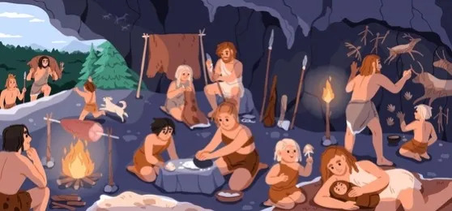
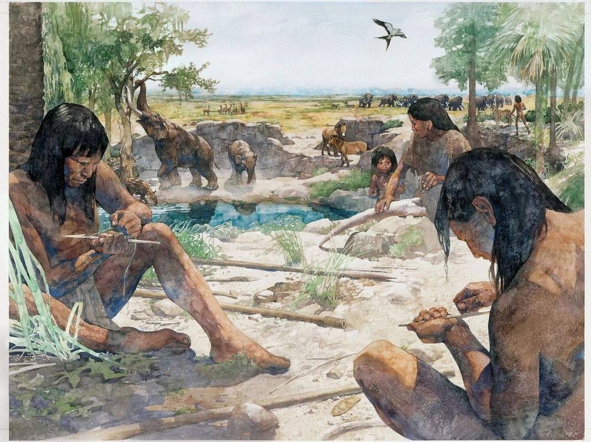
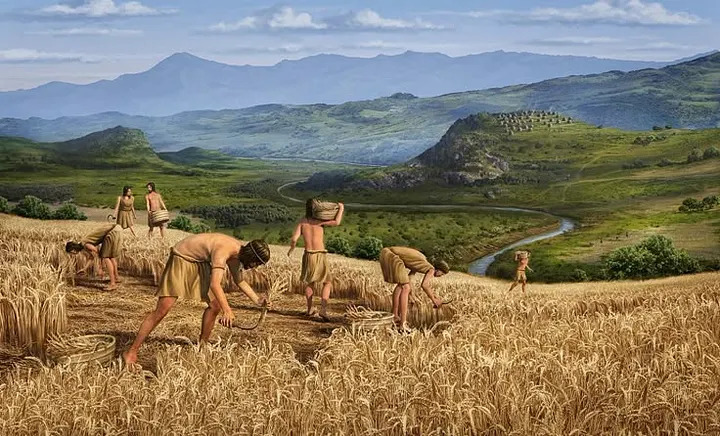

import { Link } from 'gatsby';

*出典: [Why Don’t We have Enough Time?](https://medium.com/@ekrash65/why-ancient-people-have-enough-time-2c057b441444)*

*焚き火と目覚まし時計のあいだのどこかで、私たちは自由と引き換えに進歩を手に入れたのかもしれない。*

## 今朝、機械があなたを叩き起こした

音を止めて、布団から出る。足が床につくころには、その日の大半はもう誰かのものになっている。会議。タスク。締め切り。果たすべき責任。自分で選んだわけではない時間が、ずらりと並んでいる。

そして今夜も眠る前に、あなたは同じ機械に「明日も叩き起こしてくれ」と頼むのだろう。

これがどれほど奇妙なことか、私たちはほとんど立ち止まって考えない。

五万年前に巻き戻してみる。

朝の光のなかで、ひとりの男が目を覚ます。アラームはない。カレンダーもない。予定表もなければ、返事を待つメッセージの山もない。持ち物は槍が一本、毛皮が二枚、それに火。

彼は身を起こして伸びをし、あたりを見回して、こう自分に問いかける。現代を生きる私たちの多くが、一度も本当の意味で問えたことのない問いだ。

**「今日は何をしようか」**

そんなのは美化しすぎだ、と頭がすぐに反論してくる。古代の暮らしは悲惨で、過酷で、短くて、危険だったはずだ——私たちの多くはそう教わってきた。

長いあいだ、それが公式の物語だった。人類の歴史は一本の直線のはずだった。原始の苦闘があり、その先に進歩と快適さと文明が待っている、と。

ところが、考古学者たちが地面を掘り始めた。そして出てきたものが、その筋書きをややこしくしてしまった。

## 二体の骨格が語ったこと

発見されたのは失われた都市でも埋蔵金でもない。二体の骨格だった。

どちらもほぼ同じ地域から出土し、どちらも人間のものだが、生きた時代は数千年隔たっていた。

一体目は、驚くほど健康だった。骨は太く丈夫で、関節の損傷はほとんどない。歯はすり減ってはいたが健やかで、虫歯はほぼ見当たらない。よく食べ、さまざまな動き方をし、来る日も来る日も同じ作業に縛られてはいなかった人の体である。

二体目は、まったく別の物語を語っていた。歯は虫歯だらけ。背骨には関節炎の痕。骨には、同じ動作を何年も繰り返した者に残る摩耗が刻まれていた。そしてこの人物は、より若くして死んでいる。

どちらが狩猟採集民で、どちらが農耕民か。そう訊かれたら、多くの人は同じ答え方をするだろう。健康なほうが農民で、傷んだほうが「原始人」だ、と。

事実は、ちょうど逆だった。

丈夫な骨は狩猟採集民のもの。傷んだ骨は農耕民のもの——私たちが普通「より進んだ社会」と呼ぶ側の人間のものだった。

しかも、これは例外的な一例ではない。研究者たちは同じパターンを何度も見つけている。農耕が狩猟採集に取って代わった多くの地域で、人々の背は縮み、歯の健康は悪化し、体の酷使は増え、全体として健康状態はしばしば下向きになった。

進歩というものは、そう単純な話ではなくなってくる。

私がいちばん惹かれるのは、骨格が一種の日記だという点だ。持ち主が去ったあとも、骨は覚えている。どう動いたかを覚えている。何を食べたかを覚えている。怪我も、病も、労働も、ストレスも記録している。数千年のちに、科学者はその日記の断片をまだ読むことができる。

そして古代の日記が示唆しているのは、槍を手にしていた人々の暮らしが、私たちが思い描いてきたほど苛酷で惨めなものではなかったかもしれない、ということだ。少なくとも、現代の私たちが「苦労」と呼ぶものとは違う形で。

## ある一日を想像してみる

とはいえ、骨が教えてくれることには限界がある。体に何が起きたかは分かっても、ありふれた一日がどんな感触だったかまでは分からない。

だから、想像してみよう。

日が昇る。アラームでも、通知でも、会議のリマインダーでもなく、ただの陽の光で。

昨夜の火はまだ燃えている。人々はその周りに座り、先日の狩りの残りを食べている。近くで見つけた動物の足跡の話をする者がいる。水のありかを話し合う者もいる。その日の計画が、自然に形になっていく。

そして今日は、誰も狩りに出る必要がない。前回の狩りがうまくいって、食料はまだ残っているからだ。

ある者は植物を採りに行く。ある者は道具を直す。衣類や毛皮や細工物に手を入れる者もいる。人が話す。人が教える。人が笑う。

昼過ぎには、やるべきことの大半が片づいている。残りの時間は、彼らのものだ。

怠けているからではない。生き延びるのに、果てしない労働は必要なかったからである。

## 速いから勝つのではない

数日が過ぎ、食料が心もとなくなる。狩りが必要になる。ここで、もうひとつの思い込みが崩れる。

現実の狩りは、映画とはずいぶん違っていた。

人間は自然界で足の速い生き物ではない。獲物になる動物のほとんどは、人間より速く走れる。人間が並外れていたのは、持久力のほうだった。私たちは汗をかく。体温を効率よく調節できる。多くの動物が体温の上昇に耐えられなくなってからも、動き続けることができる。

だから狩人は、獲物を追って全力疾走したりはしない。一定の歩調で、ただ追い続ける。

獲物が走る。狩人は歩く。獲物がまた走る。狩人は歩き続ける。

何時間も経つ。獲物は消耗していく。狩人は歩みを止めない。やがて獲物は、熱と疲労で崩れ落ちる。

人間が勝ったのは、強かったからではない。速かったからでもない。やめなかったからだ。

狩りに丸一日かかることもある。けれど一度成功すれば、キャンプの全員が数日食べられる。明日にはまた、自由な時間が戻ってくる。

## カラハリで見つかったもの

ここまで読んで、話がうますぎると感じるかもしれない。現代批判のためにこしらえた牧歌的な作り話ではないか、と。

同じことを考えた人類学者がいる。

1963年、リチャード・リーはカラハリ砂漠に向かった。狩猟採集を主な生業として暮らしていた数少ない人々のひとつ、ジュホアンシ（クン・サン）の調査のためである。

彼が予想していたのは、苦難だった。生き延びるための終わりのない闘いに囚われた人々だった。当時の人類学が、おおむねそう信じていたからだ。

実際にそこにいたのは、確かに働いてはいるけれど、現代社会が想像するような絶え間ない労働に追われてはいない人々だった。起きている時間のすべてを食料の確保に費やしてなどいなかった。

そして何より、彼らは現代人が渇望しているものを持っていた。

**時間だ。**

お金ではない。テクノロジーでもない。地位でもない。

会話をする時間。関係を育てる時間。物語を語る時間。共同体のための時間。ただ在るための時間。

## そして、農耕がやってきた

人類史における最大級の変化が始まる。

初め、農業は奇跡のように見えた。食料が増える。暮らしが安定する。大人になるまで生き延びる子どもが増える。人口が増える。定住地ができる。やがて都市が生まれ、交易が生まれ、政府が生まれ、文明が生まれた。

しかしその成功の内側には、新しい循環が仕込まれていた。

食料が増えれば、養える人が増える。人が増えれば、もっと食料が要る。もっと食料が要れば、もっと耕さねばならない。もっと耕すには、もっと働かねばならない。

狩猟採集と違って、農業には「終わり」がない。畑には種を蒔かねばならない。作物には水をやらねばならない。実れば刈り取らねばならない。収穫は蓄え、守らねばならない。

労働が、常態になった。

そしてその恒常的な労働が、時間をかけて社会をどんどん複雑にしていった。村は町になり、町は都市になった。都市は制度を生み、制度は日程表を生み、日程表は時計を生んだ。

やがて目覚まし時計が、人々に一日の始まりを告げるようになった。

## 節約された時間は、どこへ行ったのか

皮肉は、見ないふりができないほどはっきりしている。

私たちは、時間を節約するために作られた道具に囲まれて暮らしている。洗濯機は何時間もの手仕事を省く。車は移動の時間を縮める。スマートフォンは連絡にかかる時間を減らす。コンピュータは、かつて何日もかかった作業を自動でこなす。

新しい発明はどれも効率を約束し、どんな革新も自由な時間を約束する。

それなのに、ほとんどの人はかつてないほど忙しい。

ここで、私はひとつの問いから離れられなくなる。

**これだけの機械が時間を節約してくれたのなら、その節約された時間はどこへ行ったのだろう。**

たぶん、それこそが本当の謎なのだ。

五万年前、人は目覚めてこう問うことができた。「今日は何をしようか」

今日、私たちの多くは目覚めてこう問う。「今日は何をしなければならないのか」

この二つは、ほとんど同じ文に見える。けれど、人生との関わり方としてはまるで別物だ。一方は選択の上に成り立ち、もう一方は義務の上に成り立っている。

おそらくそれが、古い骨の下に埋もれていた物語なのだろう。

祖先のほうが豊かだったという話ではない。安全だったという話でもない。暮らしが楽だったという話ですらない。

ただ、焚き火と目覚まし時計のあいだのどこかで、人類は少しずつ、自分の時間を自分で持つことをやめてしまった——そういう話だ。

これだけの快適さと技術と進歩に囲まれながら、それでも何かが足りないと感じる人がこんなに多いのは、たぶんそのせいだ。

足りないのは成功ではない。利便性でもない。富でもない。

ほんの少しでいいから、本当に自分のものだと言える時間である。

---