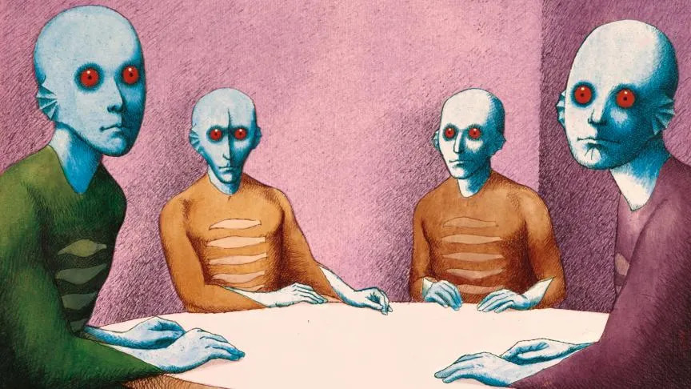
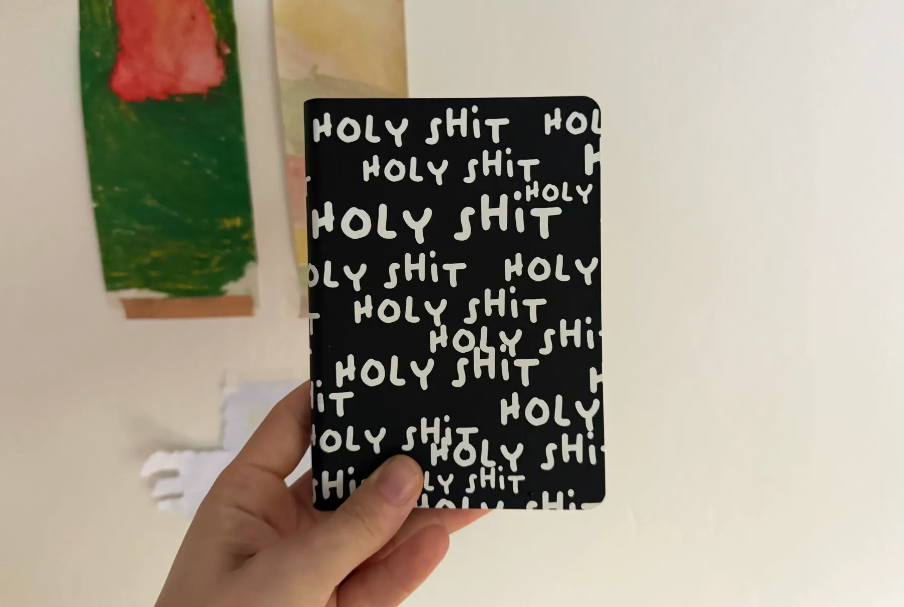

import { Link } from 'gatsby';

*出典: [The taste paradox: why the skill everyone says matters is the one we’ve stopped building](https://uxdesign.cc/the-taste-paradox-why-the-skill-everyone-says-matters-is-the-one-weve-stopped-building-32d1523f1f95)*

## みんなが「これからはこれだ」と言うスキルを、私たちは育てるのをやめた



AI時代にものをつくるうえで、最後に残る人間の力は何か。デザイナーやクリエイターに聞けば、たいてい「センス」という答えが返ってくる。良し悪しを見分けるだけでなく、まだ形になっていないものの中に化けるかもしれない兆しを見つける力。これだけは明け渡せない、と。

ひとつ断っておきたい。日本語で「あの人はセンスがいい」と言うとき、私たちはそれをほとんど生まれつきの何かとして扱っている。この記事は、まずそこが間違っている、という話だ。センスは授かるものではなく、育てるものだ。そして、育てるのをやめれば落ちる。

私もそう思う。でも、と続けなければならない。純粋な意味でのセンスは、いままさに断末魔をあげている。

あなたが「あの人はセンスがいい」と思い浮かべる、その人でさえ、自分の舌を鍛えるためのリスクを取れていない。そして私たちは社会として、そもそも何がものをセンスのいいものにしていたのかを、もう思い出せなくなっている。

## なぜ、いまこれを書くのか

プロダクトの世界にはいま、ひとつのコンセンサスがある。デザインの仕事は「つくること」から「選ぶこと」へ移っていく、というものだ。今年のカンファレンスシーズン、私はこの話を何度も何度も聞かされた。

技術の進歩としては、ごく自然な一歩に聞こえるかもしれない。私には、心底おそろしい話に聞こえる。

キュレーションは、逃げだ。

つくる量を減らして、選ぶ精度を上げる。そう言っているに等しいからだ。しかもその「選ぶ」作業は、もう個人やチームの手にはない。AIと二人三脚で、場所によってはAI主導ですでに回っている。

ここで私は、そろそろ退場させてもらいます——と言いたくなる。

でも、言わない。

季節が移るのを眺めるのが好きだからだ。庭が自分の手に負えなくなっていくのが好きだからだ。身体の中で人間をまるごと一人育て、その子を産み出すために自分の限界まで追い込まれるのが——あれが、好きだったからだ。

つまり私は、人間でいることが好きなのだ。自然で、制御できなくて、キュレーション不可能なものを体験することが。私たちがここにいる理由は、たぶんそこにある。そして、いま与えられつつあるものを、誰も頼んだ覚えはないはずだ。丁寧に管理されたナラティブ。どれも同じものの海。そして、なんとなく何かがズレているという感触。

順を追って説明させてほしい。

## バブルの中は暖かくて快適だ。外は、こわい

私たちはバブルの中で生きている。テック企業は何十億ドルも投じて、私たちの体験をこう設計してきた——好きじゃないかもしれないもの、興味がないかもしれないもの、居心地の悪い気持ちにさせるかもしれないものに、二度と出会わなくて済むように。

紙の上ではユートピアに見えるこれが、たぶん今日の問題のほとんどの出発点になっている。政治的な過激化。孤独の蔓延。ファストファッション。数えればきりがない。そして、判断力の急速な劣化も、間違いなくその一つだ。バブルは、舌を狭くする。

見知らぬ人と酔っぱらって話し込んだ流れで新しい音楽を知った日を、私はもう思い出せない。薄暗いパブの前を通りかかって、中で鳴っている曲が何なのか気になった日も。いまのパブでは、どこでも同じ音楽が流れている。できるだけ広い層の好みに当たるよう、プロの手で選び抜かれた曲が。見知らぬ人同士がニッチな趣味の話をすることも、めっきり減った。最新の政治的な騒ぎについて語るのに忙しいし、正直に言えば、普通から外れたことを口にするのが怖いのだ。それでバブルが割れたらどうする。外は、ひとりだと、こわい。

コリン・ウィルソンは1956年の『アウトサイダー』で、人類の歴史を通じて社会の規範の外側で生きるとはどういうことだったのかを書いた。（この続きを、インターネットとソーシャルメディアとアルゴリズム、そして最後にAIがこの30年ほどで何を変えたのかという視点で、誰か書いてくれないだろうか。）

要約すればこうだ。イノベーションも、芸術の発展も、そう、テクノロジーも、人類の歴史を通じて、慣習の外に出て「常識」の境界を押し広げることによって可能になってきた。私の知るかぎり最も成功している人たちが、同時に最も好奇心の強い人たちであるのは、偶然ではない。

## で、これがセンスと何の関係があるのか

好奇心は猫を殺すかもしれないが、猫をもっといい人生に導くこともある。その「かもしれない」というリスクこそが、「より良い」を可能にしている。

そして私たちはいま、史上もっともリスクを取らなくなっている。

デザインの組織で10年近くリーダーをやってきたが、デザイン原則を議論するとき、必ずと言っていいほど「馴染みやすさ（familiar）」のような言葉が出てくる。

ユーザーに見慣れたパターンを認識してもらって、物事をシンプルにする。一見すると、いい原則だ。シンプルさはUXの重要な柱なのだから。でも——ここで何人か敵に回すかもしれないが——私たちはものを、シンプルにしすぎた。

楽な道を選び続けた結果、何が良くて何が良くないのかを判断すること自体が難しくなってしまった。なぜか。見慣れなさというリスクが、「良い」を成り立たせる柱のひとつだからだ。いま私たちが「ベストプラクティス」と呼んでいるものより優れた解は、違うものの中からしか出てこない。

過剰な競合ベンチマークから始まったこの流れは、すべてが似たり寄ったりに見える世界に行き着いた。大胆な選択でさえ、ただの「選択」になった。プロダクト体験の根っこではなく、オプションの一つに。

そしていま、AIがあらゆる現場のデザインプロセスをほどき、つくるコストがかつてなく安くなった。ここで私たちは何をしたか。立ち止まって、浮いた時間をリスクに投じることを考える——のではなく、さらにリスクを削った。同じものを、もっと速く出荷するようになった。

LLMがこれほどうまく機能しているのは、私たちが少なくとも20年、同じようなウェブサイトとアプリを2種類ほど作り続けてきたからだ。あれを作るのに、何千人もの意欲的なテックワーカーは、そもそも要らない。

デザインリーダーもクリエイターも、屋根の上からセンスの重要性を叫んでいる。私自身、つい最近もデザイン判断についての講演をした。でも私たちは、本当に難しい部分にまだ触れていない。センスは、そもそもどうやって育てるのか。何かが探求する価値のあるものかどうか、育てる価値があるかどうか、戦う価値があるかどうかを、どうやって見分けるのか（余談だが、どんなデザイン上の判断も、最後はコストに対して弁明させられる）。

自分のために丁寧に選び抜かれたものの外へ出ることがこれほど難しい世界で、そんなことがわかるのだろうか。

## 干し草の山を燃やして、針を見つけろ

```
I feel like a magician
But the trick’s on me
To find a needle in a haystack
Well, it’s plenty easy
You just burn down the haystack
And then you’ll find what you need
There ain’t no obstacles that are stronger than greed

[訳]
手品師になった気分だよ
だけど、騙されているのは自分の方さ
干し草の中から針を探すなんて
実は、朝飯前（あさめしまえ）なんだ
干し草の山を、焼き払っちまえばいい
そうすれば 欲しいものはすぐに手に入る
強欲（ごうよく）の力に勝てる障害なんて、この世には存在しないのさ
```

[Jack White, All alone again, 2026](https://genius.com/Jack-white-all-alone-again-lyrics)

ここからがこの文章の本体だ。二つに分けてある。センスをどう育てるか、そして人をどう動かすか。以下は私がやっていることにすぎない。他にも無数のやり方がある。

## センスの育て方

### 摩擦を歓迎しろ

居心地の悪い真実から始めよう。すでに「好き」なものをもっと消費したところで、センスは育たない。センスは筋肉だ。筋肉は負荷をかけないと大きくならない。

だから、摩擦を探しに行くこと。週に一度でいい、自分なら絶対に選ばないものに触れる。嫌うために見るのでも、だらだらスクロールするのでもなく、ちゃんと注意を向ける。Spotifyの研究者たち自身が見つけているが、人の音楽の聴き方が多様になるとき、それはアルゴリズムから離れたときに起きていた。

より良いものをつくる側でも同じだ。iPodとiPhoneのデザインを率いたトニー・ファデルは、チームに向かって「痛みに踏み込め」と言い続けていた。彼が指していたのはユーザーの最大の痛点を探すことだったが、あの言葉には摩擦についての強いメッセージも入っている。簡単なものばかり作るな。難しい問題を解け。最初は理解できなくても——いや、最初は理解できないからこそ。

### 嫌いなものを、説明できるようになるまで観察しろ

「なんか好きじゃない」はセンスではない。反射だ。センスは、その理由を言えたところから始まる。

そして理由を言えるようになると、意見が変わることもある。変わらないこともある。でも少なくとも、自分がどうやって判断しているのかはわかる。反射も直感もすばらしい。ただ、クリエイティブな仕事をする人間にとって、自分がなぜそう反応したのかを理解することは、主観が混じらざるを得ないアウトプットを判断するうえで決定的に重要だ。

### 源流を辿れ

フィードに流れてくるものは、コピーのコピーのコピーだ。遡ること。最初にやったのは誰か。その人は何に対して反発していたのか。

センスとは、それがどこから来たのかを知っていることだ、と私は思っている。だから私は50年代の本を読む。源流まで戻ると、自分の主張は強くなるし、そこから現在への線を自分で引けるようになる。意見が急に「自分のもの」になる。誰かの、あるいは全員の意見ではなく。パターンやトレンドが、あたり一面に貼り出される前に見えるようになる。あれはあれで、ひとつの知性だと思う。

### とにかく作れ

つくらないキュレーションは、ただの買い物だ。

作ること。ひどい出来でも、途中で嫌になっても。もしデザインが本当にキュレーションになっていくのなら、最良の目を持つのは、何年もかけて凡庸なものを作り続け、自分が作れたものと作りたかったものの差を、肌で感じて理解してきた人間になる。

ここで、あのカンファレンス会場の誰も触れたがらなかった問いが出てくる。もしジュニアがAIの出力をキュレーションすることしか経験しないなら、次の世代のセンスはどこから来るのか。

### 逃げるな

人間を入力源にすること。オンラインではなく、現実で。蚤の市でものを売っているおじさん。書店員の手書きPOP。聞いたこともない仕事をしている変わった隣人。

新しいものは、見知らぬ人やゆるい知り合いからやってくる。定義上、彼らはあなたのバブルの外に住んでいるからだ。歓迎すること。話しかけること。議論すること。必要なら、意見を違えること。

先日、親しい友人と散歩に出かけた。私たちは政治的にはほぼ正反対の場所にいて、多くのことで明確に意見が合わなかった。歩んできた人生もまるで違う。それでも会話はとても豊かで、お互いをブロックすることにもならず、二人とも何かを学んだ——根本的な考えを変えることもないまま。人間と人間の対話。センスが形づくられるのは、あそこだ。

### そして、書き留めろ

センス日記をつけること。何に心が動いたか、何に動かなかったか、なぜか。言語化されたセンスだけが、守り抜けるセンスになるからだ。



私のセンス日記。アイデアと走り書きと引用でいっぱいだ。

## 人を動かす方法

どんなデザイン上の判断も、いずれコストに対して弁明させられる。そして「なんとなくこっちが正しい気がする」が、ロードマップレビューを生き延びたことは一度もない。私が一緒に働いてきた最良のデザインリーダーたちは、自分の判断の枠の作り方がうまくて、うなずく以外の選択肢がほとんど残らなかった。どう語るかを選ぶところから、センスは始まっている。

### センスを、結果に翻訳しろ

美しいかどうかに、誰も興味はない。みんなが知りたいのは、それがうまくいったら何が起きるかだ。賭けの中身を名指しすること。人は何を感じ、何を覚えて、何を友達に話すのか。

そのためには、危ない案を安全な案の隣に並べて見せる必要がある。これこそ、つくるコストが安くなったことの贈り物だ。浮いた時間を使って、当たり前の案と一緒に奇妙な案のプロトタイプも作ること。プロトタイプはまさにそれが得意だ——物語を語るのを助けてくれる何かを、目の前に出すこと。

人は議論に恋をすることはできないが、手で触れるものには恋をする。

### 自分という土壌に根を張らせろ

ブランドの物語から育った大胆な選択は、ちゃんと着地する。大胆に見せるためだけの大胆な選択は、しない。これは人にも当てはまる。なぜこの意見が自分から生えてきたのかが伝わる形で枠を作れば、主張は強くなる。

たとえば私は、キャリアのほとんどを「ベストプラクティスはベストプラクティスになった瞬間に時代遅れになる」と言い続けることに費やしてきた。だから最近の会話型インターフェースのプロジェクトで、よくある親しみやすい擬人化エージェントのようには設計せず、人間の会話を模倣することを一切やめて端的な応答に振る、と主張したとき、私にとってそれは自然なことだった。自分が立っている場所と、直結していたからだ。

### 信用は、お金のように使え

稼いでから、四半期に一度の本気の戦いに使う。どの戦いが戦う価値があるかを見極めることも、あなたのセンスの重要な一部だ。

個人的に強い思い入れのある選択でも、ユーザーにとってはどうでもいいかもしれないし、経営陣と対立してまで通す価値はないかもしれない。戦わないことも、自分のセンスを信じるひとつの形だ。私が戦わないと決めたとき、そのプロジェクトはたいてい遅かれ早かれまた私の机に戻ってきて、今度は揉めずに直せる。

### 公の場で、間違えろ

これはリーダー向けだ。

チームはリーダーのリスク許容度を真似る。ディレクターが安全なものしか出荷しないなら、全員が安全なものしか出荷しなくなる。

私の講演が好まれるのは、いつも失敗をたくさん持っていくからだ。うまくいかなかったこと、自分がやらかしたことを話す。そして、あなたも同じことを恐れずにやってほしい、と伝える。

## だから、あなたの干し草の山を燃やせ

センスが死にかけているのは、AIが良くなったからではない。私たちが餌をやるのをやめたからだ。味見をフィードに任せて（しゃれではない）、それで全部同じ味がすると驚いている。そりゃそうだろう。

キュレーション派の言うことは、間違ってはいない。仕事の中身は確かに変わりつつある。でも、鍛えたことのない目でキュレーションはできないし、あなたを快適に保つために作られたバブルの中で目は鍛えられない。

もしデザインの未来が本当に「選ぶこと」なのだとしたら、私たちの最も重要な仕事は、選ぶために座るずっと前に起きている。レコード屋で。違う政党に投票する友人との散歩の途中で。ひどい初稿の中で。誰にも薦められなかった1956年のペーパーバックの中で。

これが、私があなたに取ってほしいリスクだ。リブランドではない。ムーンショットでもない。もっと小さくて、ずっと難しいこと。意図的に道に迷うこと。アルゴリズムが「これ好きかもよ」と言ってくる前に、何かを好きになること。チームの前で、声に出して間違えること。

ジャック・ホワイトは正しい。針は、もっと必死に探しても見つからない。干し草の山を燃やすのだ。

これであなたのプロダクトが来四半期に良くなるとは約束できない。でも、あなたが簡単には替えのきかない人間になることは約束できる。モデルがあなたの代わりにキュレーションできない唯一のものが、あなたが自分で外に出て見つけてきたものだからだ。

問題なら99個ある。センスがその1個にならないようにしよう。

---