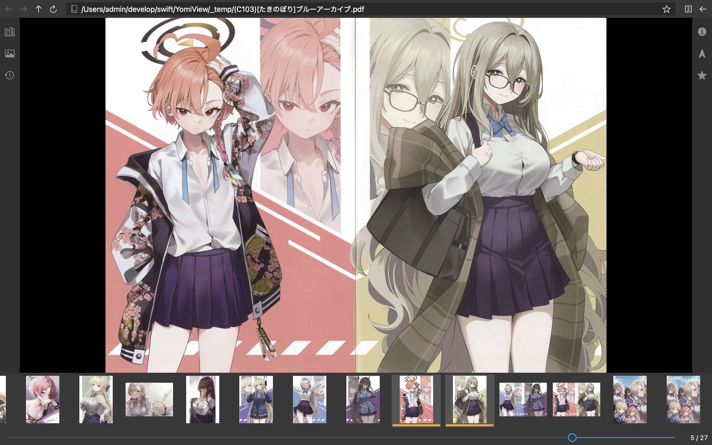
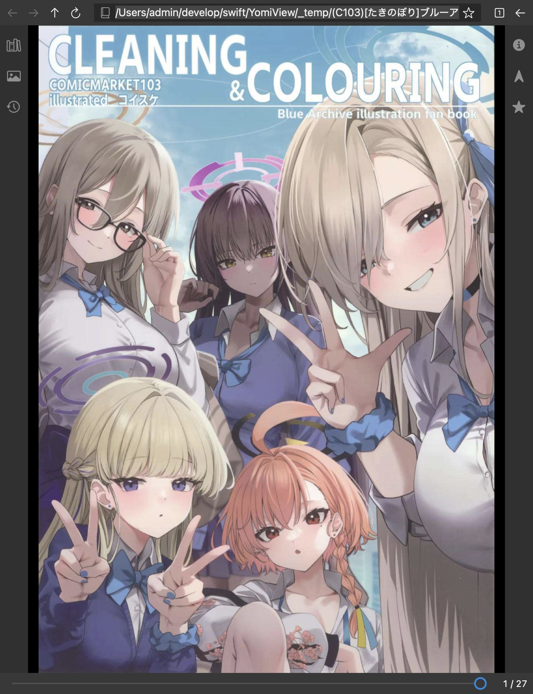
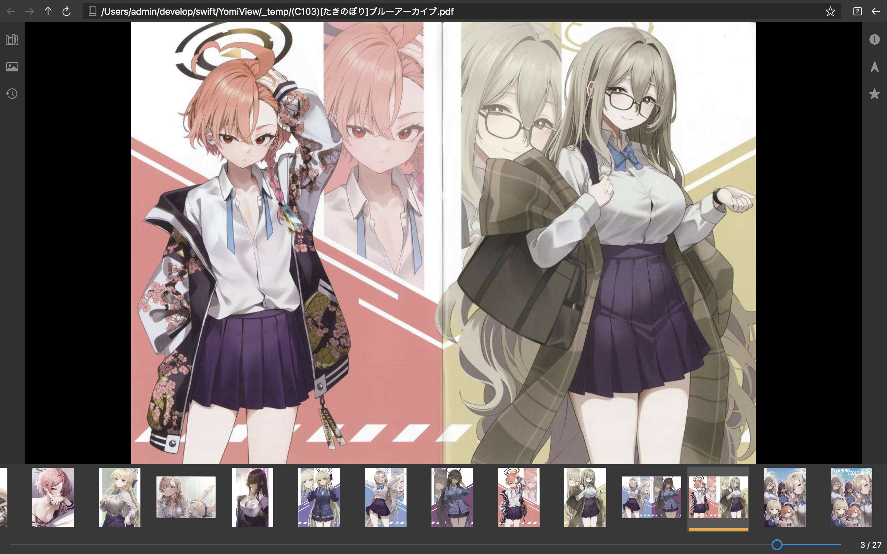
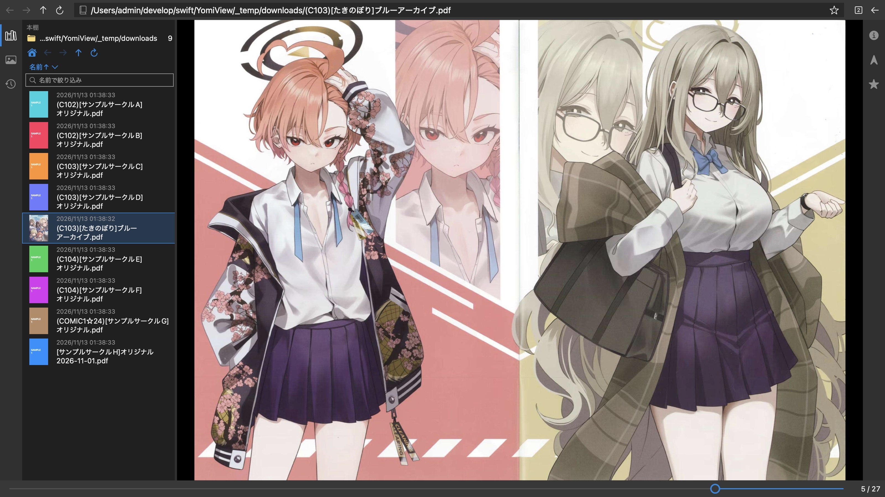
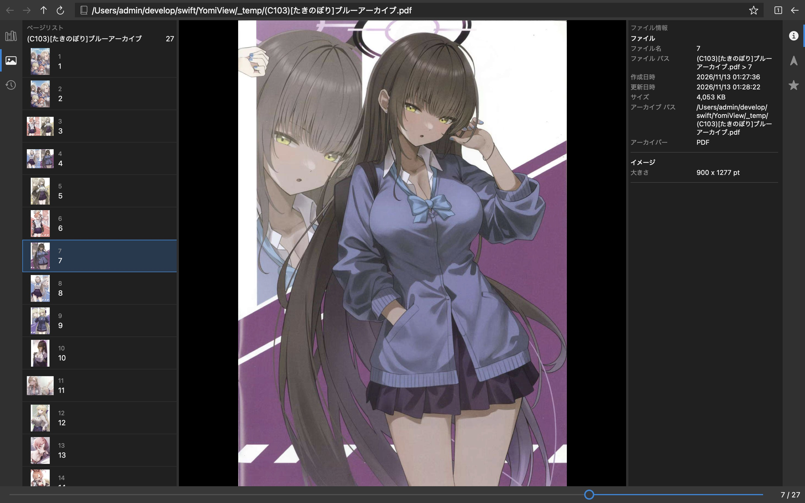
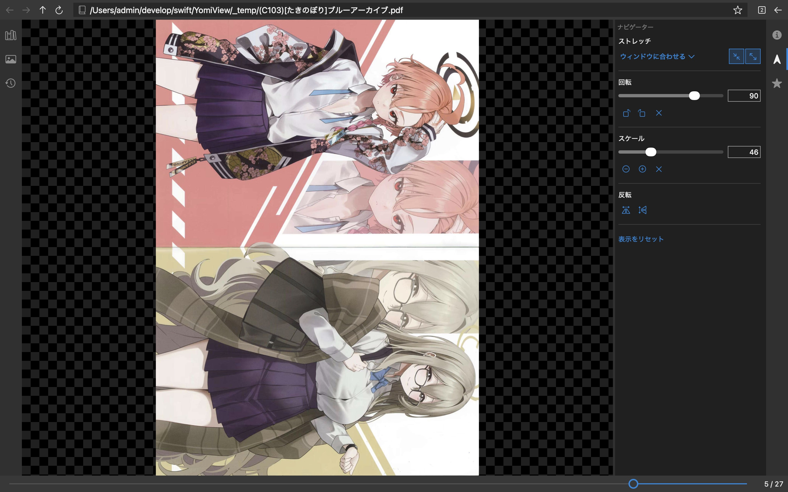
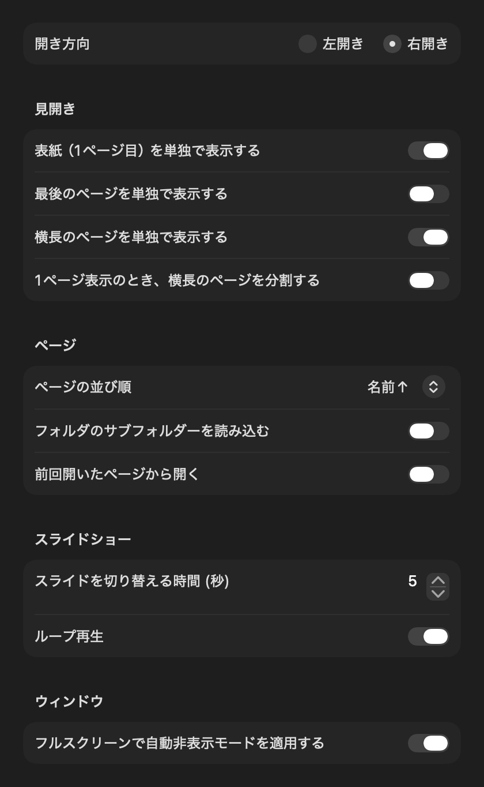

import { Link } from 'gatsby';

以前、同人誌の毎日の更新分を自動でダウンロードして整理する Python ツール「[Doujin Archiver](/blog/2025-11-09/)」を作りました。おかげで PDF は勝手に溜まっていくようになりました。次に困ったのは、それを **Mac でどう読むか** です。

Windows では、画像・漫画ビューアに [NeeView](https://github.com/neelabo/NeeView) を使っていました。PDF やフォルダ、ZIP をそのまま「本」として開け、見開き・右開きで読めます。本棚パネルから同じフォルダの次の本へどんどん移れるので、Doujin Archiver が保存したフォルダを上から順に読んでいくのにぴったりでした。

ところが Mac には、これと同じ感覚で使えるビューアがなかなか見つかりません。プレビューは右開きの見開きが苦手で、1冊読み終えるたびに Finder に戻って次の PDF を開き直すことになります。ほかのアプリは、ZIP の中の日本語のファイル名が文字化けしたり、パネルまわりが物足りなかったりしました。

そこで、NeeView の中核機能を Swift / SwiftUI で作り直した macOS 用の画像・漫画ビューア **YomiView** を作りました。Doujin Archiver が「集める」担当なら、YomiView は「読む」担当です。

- GitHub：[kiyohken2000/YomiView](https://github.com/kiyohken2000/YomiView)
- ダウンロード：[Releases](https://github.com/kiyohken2000/YomiView/releases/latest)（`YomiView-1.0.0.dmg`）

## どんなアプリか

画像の入ったフォルダ、ZIP / CBZ、PDF を「本」として開き、ページをめくって読むビューアです。

- 開ける本：フォルダ、ZIP / CBZ、PDF
- 画像形式：PNG、JPEG、GIF、WebP、BMP、TIFF、HEIC
- 対応 OS：macOS 14 以降（Apple シリコン / Intel のユニバーサル）
- Developer ID で署名し、Apple の公証も通しているので、ダウンロードしてすぐ起動できます

見た目は NeeView のダークテーマに合わせました。上にアドレスバー、左右にパネルのアイコン列、下にフィルムストリップとページスライダーを並べています。ただし、メニューは Mac らしくメニューバーに置いています。

## 主な機能

### ウィンドウの形で見開きと1ページが切り替わる

ウィンドウを横長にすると見開き、縦長にすると1ページ表示に自動で切り替わります。M キーで手動でも切り替えられます。初期値は日本の漫画に合わせた右開きで、D キーで左開きにできます。

表紙（1ページ目）は単独で表示します。見開きでスキャンされた横長のページも自動で単独表示になり、ページの組み合わせがずれません。

設定を変えれば、最後のページを単独で表示したり、1ページ表示のときに横長のページを左右に分割したりもできます。

### 溜まった PDF を次々に読む

Doujin Archiver と組み合わせるうえで一番欲しかったのが、この機能です。

1冊読み終えたら、⌥↓ で同じフォルダの次の本が開きます。Finder に戻る必要はありません。本棚パネルには、そのフォルダの本が表紙のサムネイル付きで一覧に出るので、タイトルを見ながら選ぶこともできます。

Doujin Archiver は、イベント名の表記をそろえて `(C103)[サークル名]原作名.pdf` の形式で保存します。そのため、本棚を名前順で並べると同じイベントの本がまとまり、上から順に読んでいけます。名前で絞り込む検索欄もあります。

ほかにも、読みかけの本を後で開き直すための「最近開いた本」と履歴パネル、気に入った本を残しておくブックマークがあります。

### ページ送りはキー・スクロール・スライダーで

- ← → ↑ ↓、Space でページ送り（右開きなら ← が次のページ）
- 上下スクロールでもページ送り。トラックパッドは1回のスワイプで1ページだけ進み、慣性スクロールでは進みません
- ページスライダーとフィルムストリップで好きなページへ
- 最後のページで次へ進もうとすると「最後のページです」と表示

トラックパッドでのページ送りは、意外と調整が大変でした。普通にスクロールイベントを拾うと、慣性で何ページも飛んでしまいます。そこで、指を置いてから離すまでを1回の操作とみなし、一定量を動かしたら1ページ送るようにしています。マウスホイールは1目盛りで1ページ送ります。

### パネル

NeeView と同じく、左右にパネルを開けます。

- 本棚：同じフォルダの本の一覧（⌥↑ / ⌥↓ で前後の本へ）
- ページリスト：サムネイル付きのページ一覧
- 履歴、ブックマーク
- ファイル情報：ファイルのパスや大きさ、Exif など
- ナビゲーター：回転、拡大率、反転

### 拡大・回転・ルーペ

ウィンドウに合わせる、幅に合わせる、高さに合わせる、といった表示サイズを選べます。拡大・縮小（ピンチにも対応）、90度ずつの回転、反転もできます。長押しするとルーペで部分的に拡大でき、背景色もチェック柄などに変えられます。

### そのほか

- スライドショー（F5）
- フルスクリーン（F）。フルスクリーンではアドレスバーやパネルを自動で隠します
- ドラッグ＆ドロップで本を開く
- 最近開いた本から開き直す
- ページの並び順の変更、サブフォルダーの画像の読み込み

## 技術的な話

### 構成

- Swift 5 / SwiftUI（`@Observable`）、macOS 14 以降
- 外部ライブラリは ZIP を読むための [ZIPFoundation](https://github.com/weichsel/ZIPFoundation) だけ
- PDF は PDFKit、画像の読み込みは ImageIO
- Xcode プロジェクトは XcodeGen の `project.yml` から生成
- コードは Swift で約 7,000 行（テストを含む）

フォルダ・ZIP・PDF の違いは `PageProvider` というプロトコルの中に閉じ込めています。View 側は本の形式を気にせず、「何ページ目の画像をこの大きさで」と頼むだけです。見開きの組み合わせ（表紙単独、横長ページ、最後のページ単独など）は純粋関数の `SpreadCalculator` に切り出し、ユニットテストで固めています。

### 大きな画像をそのまま読まない

漫画のスキャン画像は大きいので、元の画像をそのまま読むとメモリがすぐに膨らみます。そこで、ImageIO の `CGImageSourceCreateThumbnailAtIndex` を使い、「表示領域の長辺 × 画面の倍率」まで縮小してから読み込んでいます。前後2ページを先読みし、8枚までの LRU キャッシュに入れているので、ページをめくってもすぐに表示されます。

### ZIP の文字化け対策

日本語版の Windows で作られた ZIP は、ファイル名が Shift_JIS になっていることがよくあります。まず UTF-8 として読み、だめなら Shift_JIS、それもだめなら CP437、という順に試して、文字化けしないようにしました。`__MACOSX` フォルダや隠しファイルは除外し、ページはファイル名の自然順（`page2` → `page10`）で並べます。

### NeeView のロジックを移植

NeeView は MIT ライセンスで公開されています。そこで挙動を近づけるため、配色や本棚の並び順、表示サイズの計算、見開きの判定などの一部を C# から Swift に移植しました。移植した範囲は、リポジトリの `NOTICE.md` に一覧にしています。

### 配布

Developer ID で署名し、Hardened Runtime を有効にして公証を通した DMG を GitHub Releases に置いています。Release ビルドから署名、DMG の作成、公証、ステープルまでは、`scripts/release.sh` 1本で済むようにしました。アイコンは Icon Composer の形式（`.icon`）で作っており、macOS 26 でも白い板に載らずに表示されます。

### Claude Code で作った

[Ember](/blog/2026-04-01/) のときと同じく、今回もほぼ Claude Code とのペアプログラミングで作りました。

最初に実装計画書を書き、「フォルダと ZIP の1ページ表示」から「スライドショーとフルスクリーン」まで、15のフェーズに分けて順に作ってもらいました。計画書にない判断はすべて `DECISIONS.md` に記録するルールにしたので、「なぜこうなっているのか」をあとから追えます。骨組みを作ってから v1.0.0 を公開するまで、2日ほどでした。

## まとめ

これで、Doujin Archiver で毎日 PDF を集め、YomiView で Mac で読む、という流れができあがりました。

Mac で漫画や画像フォルダを見開き・右開きで快適に読みたい人には、きっと便利だと思います。NeeView を使っていた人なら、ほぼ同じ感覚で使えるはずです。

不具合や要望があれば、GitHub の Issues で教えてください。

- GitHub：[kiyohken2000/YomiView](https://github.com/kiyohken2000/YomiView)
- ダウンロード：[Releases](https://github.com/kiyohken2000/YomiView/releases/latest)
- 関連記事：[同人誌を自動ダウンロード・整理するPythonツール「Doujin Archiver」を作った](/blog/2025-11-09/)

---