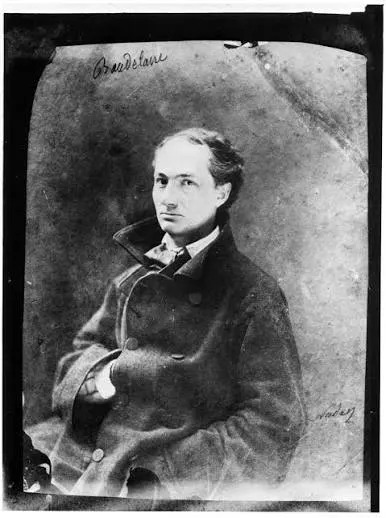

import { Link } from 'gatsby';

*出典: [Every new medium gets called cheating](https://uxdesign.cc/every-new-medium-gets-called-cheating-b990d7d53c0e)*

信用していなかった機械が、私にもう一度「下手であること」を教えてくれた話。

## 私は懐疑派だった

記録に残しておきたい。私もまた、反対派だった。

テッド・チャンが『ニューヨーカー』に「AIは芸術を作らない」と書いたとき、私は我が意を得たりと思った。そして記事を転送した。読みたいと言っていない人たちに。（ごめんなさい。）

彼の主張はこうだ。芸術とは何千もの小さな選択の積み重ねであり、その大半を機械に肩代わりさせたなら、そこから芸術は抜け落ちている。私はこれを食事の席で「あれは野心のある自動販売機だよ」と要約し、呆れ顔と、よくわかっていない顔をいくつか引き出した。

書くことは私のホームグラウンドだ。お気に入りのペンを14本ほど持っている。セミコロンについては見解がある。だから「代わりに書きますよ」と機械が現れたとき、私は猫が新入りの猫に対してとる態度をとった。じっと動かず、部屋の向こう側から品定めをして、向こうが出ていくのを待った。

本気で腹が立ったのは、あるクライアントが私の文章を「AIっぽすぎる」と言ったときだ。理由は、愛用のオックスフォードコンマと、頼れるダッシュ。そこから話は個人的な問題になり、以来ずっとそうだ。

AIは私が誇れるものを、ひとつも作っていない。でも、もっと奇妙で、正直もっといいことをした。私を、もう一度初心者になれるくらい勇敢にしたのだ。何年も怖くて触れずにいた分野で。

説明させてほしい。

## どの分野にも門番がいる

どの分野にも門番がいる。人ではなく、感覚のことだ。そして門の開きやすさは、分野によってかなり違う。

陶芸教室なら、それは「いい釉薬の隠し場所をみんなが知っていて、自分にだけ教えない約束になっている」という感覚。コーディングなら「ターミナルとは何かと質問する資格を得るには、あらかじめターミナルを知っていなければならない」という疑念。

門番は才能を見ない。あなたがここに属していそうかを見る。そして大人になってからの人生の大半、私は新しい分野の扉まで歩いていき、門番と目を合わせ、「やっぱりいいです、私はライターなので／デザイナーなので／これではないので」と言って帰ってきた。

なぜか。まあ、インポスター症候群だ。どれだけうまくいっても誰もがそれを感じている、と認められるまでに35年ほどかかった。

私はかなり能動的に、自分を転向させようとした。

認めたくはないが、そこでAIが果たした役割は思っていたより大きい。それでもここで認めるのは、効いたのが予想していた部分ではなかったからだ。機械が何かを作ってくれたからではない。ようやく、駄目な質問ができるようになったからだ。夜の11時に。40回連続で。誰にもため息をつかれず、スマホを見られず、「まあ、かなり基本的な話だけどね」と言われることもなく。これで、あれほど恐れていた学習曲線が、完全に自分の管理下で、自分のペースのものになった。シーシュポスの坂ではなく、楽しいウォータースライダーの側に。

というわけで、たとえば……本当に立体的なキャラクターはどう書くのか。ウェブのリポジトリとは何か。そしてピカソの何が自分にはわかっていないのか。

三つの質問。三つの分野。昔の私なら、文章講座と、とても辛抱強いエンジニアの友人と、あと美術史の学位が必要だった。

今の私に必要だったのは、一晩と、ゼロのプライドだけだ。

ちなみに勇気が出たのは私だけではない。スタンフォードとMITの研究者が5,000人を超えるカスタマーサポート担当者にAIアシスタントを渡したところ、最も新しく経験の浅い人たちは1時間あたりの処理量が34%増えた。ベテランは？　ほとんど変わらなかった。研究者の説明はこうだ。このツールは経験者が持っている知識を受け渡し、新人が学習曲線を早く下るのを助ける。

訳すと、AIは専門家にはもったいなく、初心者への贈り物である。そして新しい分野に入るとき、初心者は誰か？

ゲートキープイングの正体は、ほとんど私自身だった。自分で自分の店の入口に立っていたのだ。

## リプライ魔たちの短い歴史

心が慰められるのは、人類がこれまでに何度も、本当に何度も同じ場所に立ってきたということだ。

紀元前370年頃、プラトンはソクラテスの愚痴を書き留めた。文字は人を忘れっぽくし、本物の知恵なしに知恵があるように見せかける、と。文字だ。私のホームグラウンド。史上最初のAIパニックは、私のお気に入りのペンについてだった。（そしてソクラテスが文字を嫌っていたと我々が知っているのは、誰かがそれを書き留めたからにすぎない。）

1492年、同郷のドイツ人、修道院長ヨハンネス・トリテミウスは『筆写者礼讃』を書いた。印刷機は修道士を怠惰にするから、修道士は手で本を写し続けるべきだという熱い訴えである。そして彼はそれを印刷した。なんというディーヴァ。アイコニック。

1859年、パリ・サロンの評を書いた詩人シャルル・ボードレール（イニシャルがCBの詩人では私の二番目のお気に入り）は、写真とは才能のない怠惰な画家が隠れる場所だと宣言した。彼は炎上が好きだった。コメント欄があったら、絶対にそこに住んでいた。

*ナダールが撮ったボードレール、1855年頃。*

同じ頃、画家ポール・ドラローシュは「絵画は死んだ」と言ったと伝えられる。絵画はそれから165年ほど死んだままで、たいへん元気だ。ギャラリーと契約している。ポッドキャストもある。たぶん信託財産もある。

一方で写真はそれ自身がひとつの分野になり、独自の天才と、独自のスノッブを持った。そのスノッブたちは今、スマホに向かって同じことを言っている。

これがパターンだ。歴史はくり返す。

新しい表現手段は必ず、古いほうが得意な人たちから「ズル」と呼ばれる。私はそれを知っている。自分がその一人だったからだ（転送したあの記事を思い出してほしい）。

でも私はその世代間連鎖を断ち切った。

リプライ魔たちがいつも見落としているのはこれだ。分野を簡単にした道具が、その分野を殺したことはない。こじ開けたのだ。そう、それはちょっと怖い。自信のない男たちにとっては特に。

1841年より前、画家は油絵具を紐で縛った豚の膀胱に入れて保管していた。そこへジョン・ゴフ・ランドという、金のないアメリカ人肖像画家が折りたたみ式のチューブを特許化した。絵具は突然持ち運べるものになり、画家は外へ歩き出した。のちにルノワールは、チューブがなければモネもセザンヌも印象派も存在しなかったと語っている。すごい話だ。

ともあれ、簡単になることは、悪くなることではなかった。簡単になるとは、より多くの人が、より多くの場所で、誰も描いたことのないものを描くという意味だった。学習曲線が下がるとそうなる。人が入れるようになるのだ。あいにく私は、それをいいことだと思う程度には意識が高い。

## 工芸とは、素材との会話である

社会学者のリッチャード・セネットは、工芸（クラフト）を素材との会話だと表現する。こちらが押すと、向こうも押し返してくる。その抵抗があるから、人は作り直し、やがて上手くなる。

木には木目がある。粘土はこちらが焦ると崩れる。水彩は好き勝手にふるまい、最後に、幼児を泣かせる「がっかりした親戚」みたいな形で乾く。

AIも押し返してくる。ただし、もっと屈辱的なやり方で。

こちらが意図したことではなく、言ったとおりのことをするのだ。しばしば、元気よく、念を押すように箇条書きで。うんざりする。

文章をたくさん書く人間にとって、これは自分の明晰さについての毎日の人事評価だ。抵抗は、頭の中にある考えと、実際に打ち込んだ（あるいは口に出した）文のあいだの隙間にある。その隙間には……手触りがある。だんだん感じ取れるようになる。

かつての自分には残念な報告だが、それはつまり、ひとつの表現手段（メディウム）だ。

ブライアン・イーノは1995年の日記に、新しい表現手段の奇妙で醜い部分は、やがてその手段の署名になると書いた。

だから私は、今のAIのクセ（指の本数、やたらな前のめりの熱意、「delve」という単語）を、新しいやさしさで眺めている。

20年後、誰かがそれをわざわざ回し直して「ヴィンテージ」と呼ぶだろう。私を知っている人なら、私がそういうものに弱いことも知っているはずだ。

## 流体は、容器の形になる

安心してほしい。私はまだ完全にクールエイドを飲み干してはいない。「未来はここにある」というキャプションで日の出の写真を投稿する人間にならずにいられる理由がある。

これについては「趣味のパラドックス」で散々書いたので、短い版を。研究者が作家たちにAIが生成した物語のアイディアを渡したところ、できあがった物語は「より創造的」と評価された。そして同時に、互いにより似通ったものになった。全員が上手くなり、全員が少しずつ同じになった。

私はAIを「流体のような表現手段」と、褒め言葉として呼んでいた。流体が何をするものかを、忘れていた。

水にはそれ自身の形がない。入れられたものの形になる。

容器はあなただ。

なかなか詩的だと思う。タッパーのほうがよければ、それでもいいけれど。

あなたの趣味、あなたの変なところ、あなただけが気づくこと。だから自分のホームグラウンドでは、私はAIを「より多くの人に届くために必要なことを教えてもらう」ために使っている。私の場合は、SNS用の素材を作ることと、一緒にやれる他の作り手を見つけることだ。

誰もかれを及第点のライターにする道具は、取り柄が及第点であることだったライターにとってだけ脅威だ。幸い私は、及第点よりは反抗的な側の人間でずっとやってきた。

## AIが触れなかった分野

ずっと興味があって、怖くて試せなかったことを、私はいま以前よりはるかに少ない恐怖で次々とやっている。というのも、AIが私に教えたのはコーディングではないのだ。ゼロから始めても死なない、ということを教えたのだ。そして自分の学び方も見せてくれた。まず駄目な質問をして、次に醜いバージョンを作る。その教訓はチャットの窓の中にとどまらない。漏れ出す。生活へ。子育てにまで。

*少し前に描いたオイルパステルの絵。*

だから私は、AIは流体のような表現手段だと思う。そして、それが残していく勇気も流体だ。ひとつのグラスに二つの液体。道具があなたを新しい分野に流し込み、勇気がそこにあなたを留める。リキッド・カレッジ（液体の勇気）、ただし二日酔いと、後悔するメッセージの送信はなし。いいことしかない。

門番は、まだ私が試していないすべての分野の扉に立っている。ただ、前より小さく見える。タックルで倒せそうな、あるいはラップバトルで勝てそうな相手に。

## で、結論は？

もう一度、初心者になること。

意図的に。ずっと怖くて試せなかった分野、門番が一番こわい分野を選ぶこと。今夜、駄目な質問をすること。そのあと、自分の実際の手で、醜いものを作ること。

---