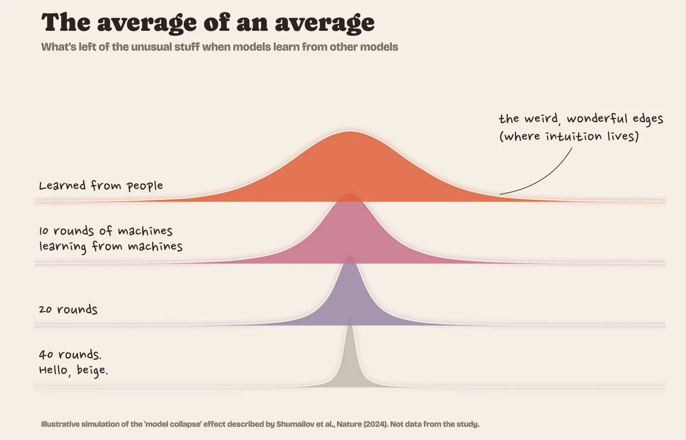
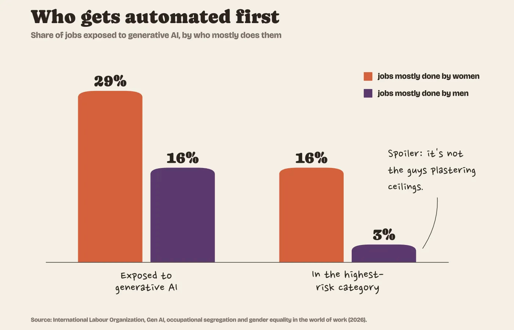

import { Link } from 'gatsby';

*出典: [Machines are trying to get gut feelings while you’re telling me to ignore mine](https://uxdesign.cc/machines-are-trying-to-get-gut-feelings-while-youre-telling-me-to-ignore-mine-17095e56f22d)*

直感はずっと、二番手の知り方として扱われてきた。いまAIは、それを自分自身から学ぼうとしている。私たちはAIから学んでいる。そしてこのループを、誰も見ていない。まあ、そういうことです。

AIについて、ひとつ予感がある。

AIについてのエッセイの始め方としては妙だと自分でも思う。でも私は、「妙じゃない人」として知られたことが一度もない。（つまり、退屈な人ということ？）

ここ最近、「テイスト」とそれがどう育つのかという議論にすっかり夢中になっている。研究論文を次から次へと読みながら、あることに気づいた。みんな、私がずっと一種の感覚として経験してきたものを、必死に数値化しようとしている。

最初にそれにぶつかったのは十一歳のときだ。なぜ自分は誰ともうまく噛み合わないんだろう、と考えはじめた。ほかのみんなを私より少しだけ「普通」にしているものは何なのか、一生懸命に突き止めようとしたけれど、どうしても名前がつけられなかった。それは自分の内側にある何かで、感情とも言いきれないし、かといって頭の中だけの話でもなかった。友達が「変」と言うものを私が美しいと思う理由。流行っている曲ではなく、ある特定の音を好きになる理由。本の中の奇妙な登場人物に肩入れしてしまう理由。そしてたぶん、女友達がみんな追いかけるタイプの男の子に心が動かなかった理由でもある。詩を書きはじめたのも、「アシッドをやったイエス」みたいな、友達いわく「テクノ・アーミッシュ」な格好をするようになったのも、まず間違いなくそれのせいだ。

不思議なことに、年を重ねるほどそこに寄りかかるようになって、ここ数年で自分のあり方にかなり自信が持てるようになった。それに、気づけば「あるものは好きで、あるものは好きではない」こと、そしてそれを人に伝えられることで、ひとつのキャリアを築いてしまっていた。奇妙さは私の物語の一部になり、私が仕事で成果を出せている理由の一部になった。アイデアを出すこと、デザイン、書くこと、そしてとくに、人を率いること。

それでも、いわゆるキャリアを何十年とやってきた今になっても、私がいちばん頼っているものには、まだ名前がつけられない。

バイブスよりは多く、事実よりは少ない。たぶん。

たいていの人はそれを直感と呼ぶ。愛情を込めてそう言う人もいるし、「根拠を出せないよね」とか「ちょっと危ない人なんじゃない」を上品に言い換える言葉として使う人もいる。

私は、これが私たちの持つ中でいちばん過小評価されたスキルだと思っている。そして、知り合いのあらゆる会社が自分たちの判断をどんどん機械に預けているいま、気づかれないまま失われる可能性がいちばん高いスキルでもある。どうやら心配しているのは私だけらしいので、この文章は、それをみんなに知らせるため、そしてできれば「これは地球が回り続け、私たちがその上で機嫌よく暮らしていくために絶対に必要なものだ」という私の信念を売り込むためのものだ。

## で、それは結局なんなのか

直感について科学が何を知っているのか、調べてみた。期待したほど神秘的ではなかった（うーん）けれど、それなりに使える。

多くの研究者はそれを、経験から築かれたパターン認識だと説明する。説明できるようになる前に到着してしまう種類のもの。ダニエル・カーネマンはこれをシステム1と呼んだ。速く、自動的で、何千回も見てきたことについてはたいてい正しい。

「女の勘」という古い常套句も確認してみた。正直、手っ取り早いフェミ的勝利が欲しかったからだ。女性は他人を読む力の平均スコアがたしかに少し高い。ただ、その差は私が思っていたよりずっと小さい。

これまででいちばん大きい研究は、57か国で30万人以上を調べ、差は実在するが小さいという結論を出した。心理学者のウィリアム・イケスは、自分の共感テストで女性が楽勝すると読んでいた。そうはならなかった。そしてクリスティ・クラインとサラ・ホッジズが「正解したら報酬を払う」形にしたところ、差は消えた。男性が急に上手くなったからだ。つまり男性だって場の空気はちゃんと読める。ただ、テーブルにお金が載っているときに限ってやる気を出す傾向があるらしい。テック業界で働いたことがあるなら、たぶん心当たりがあると思う。

白状すると、少しイラッとした。

「AIは女っぽさが足りないからバイブスを拾えない」という、私が練り上げた論は窓から飛んでいった。代わりに残ったものは、それなりに面白い。直感は、生まれつき一部の人に与えられた才能ではない。誰かが落ち込んでいること、はったりをかけていること、会議で泣きそうになっていること、計画が正しそうに見えて実はそうでないこと。そういったものに気づき続けた年月から築かれるスキルだ。スキルなら学べる。学べるなら教えられる。もしかすると、機械にも。

これは私としてはかなり食いつきたい話だ。「Head of Vibes（バイブス責任者）」は、私が馬鹿みたいに本気で取り合いにいく唯一の肩書きだと思うので。

ただ、私にその椅子が回ってくる可能性があるのは、「それは教える価値がある」と私たちが認めた場合に限る。歴史的に、私たちは認めてこなかった。

## よくても二番目、だったスキル

男は考え、女は感じる。この図式はかなり昔までさかのぼる。

数十年にわたって勘を擁護してきた心理学者ゲルト・ギーゲレンツァーは、それをアリストテレスから十九世紀まで辿っている。そして（ネタバレ）、それは一度も褒め言葉として使われていない。

ヴィクトリア朝の科学者たちは、直感に頼ることを情緒不安定と並べて、女性の自然な特性のリストに入れた。これは、女性が学んだり投票したり何かを運営したりすべきでない理由を誰かが必要とするたびに、たいへん便利に使われた。

1893年、社会学者のレスター・ウォードは「女性の直感」に一章を与え、それは自己防衛のための動物的本能だと結論づけた。たぶん彼は好意でそう書いたのだと思う。それでも読み心地は、わりと賢いアナグマについてのドキュメンタリーみたいだ。

こうして直感は残念賞になった。

男性は理性を手にした。これは数に入る。

女性は「なんとなくそう感じる」を手にした。これは、まあ、聞いてもらうことはできて、そのあとたぶん無視される。そして女性的なものとしてコード化されたせいで、このスキル全体が、女性が大学や役員会に入れてもらえるようになったずっとあとまで、誰にとっても低く見られたままになった。

ではなぜ、直感は私の人生とキャリア、そしてあえて言えば成功において、こんなに大きな役割を果たしてきたのだろう。いちばんバズった私のトーク（今年のHatchでのもの）は、「これについて話すべきだ」という予感があったから実現した。キャリアの伸びのほとんどは、何かについて予感があり、それが結果的に正しく、しかも早い段階でそれを口にしたことで上司たちがより良い判断を下せ、結局もっと面白いものが出荷できた、という形で起きている。

これを書いているあいだ、ダヴィーナ・マッコールのポッドキャスト『Begin Again』に出たジミー・カーを聴いていて、どうしても頭から離れない仮説を聞いた。クリスタルやタロット、星占いといったウーウー系のあれこれは、要するに女性が自分の直感を信じるためのお守りなのだ、という話だ。自分が何かを知っていると、どうしても信じきれないから。許可が必要で、カードがそれをくれる。彼は、彼女たちはクリスタルを信じているのではなく、自分が何かを知っていると信じているのだ、と言っていた。

これは女性とタロットの話をはるかに超えたところに刺さっていると思う。私たちのほとんどは、「自分が感じ取ったものは、裏づけられるまで数に入らない」と教わってきた。だから許可を探しにいく。ダッシュボード、データ、セカンドオピニオン、コンサルの資料、そしていまはどんどん、チャットボット。許可を求める相手としてはなかなか面白い。その部屋の中で唯一、一度も勘を持ったことがないものなのだから。とはいえ世界中の情報にはアクセスできるわけで、勘を裏づけるにはいい手段だ。これが良いことなのか悪いことなのか、私はまだ決めかねている。

ただ、直感については、ない。AIは持っていない。少なくとも、まだ。

## 機械は持てるのか？

1966年、哲学者のマイケル・ポランニーは、私たちは語れる以上のことを知っていると書いた。何千人の人混みの中から友人の顔を見つけられるのに、どうやってそれをやったのかは書き下せない。経済学者のデヴィッド・オーターはのちにこれをポランニーのパラドックスと名づけ、自動化が「手順で説明できる仕事」ばかりを食べ続け、それ以外は人間のところに残り続けた理由を説明するのに使った。

それは、まあ、つい最近まではそのとおりだった。

2016年、DeepMindのAlphaGoは、当時最強の囲碁打ちのひとりイ・セドルを相手に、人間なら打つ確率が1万分の1ほどしかない手を打った。解説者たちは、それが天才的な手なのかバグなのか判断できなかった。そしてその対局は、AlphaGoが勝った。囲碁はずっと、計算よりも直感のゲームと呼ばれてきた。そして機械はそこに、自分自身と何度も打ち続けることで、盤に対する「感覚」にかなり近いものを手にして辿り着いた。

小さな注意書き。ボードゲームは、ギーゲレンツァーが「機械が得意」と言うまさにその種類の安定した世界だ。市場、顧客、子ども、そして自分自身は、そうではない。人間的で、ぐちゃぐちゃな方の直感については、研究者たちは大きく二つのルートを試している。

ひとつめは、私たちの判断を機械に直接教えること。

いま使われているチャットボットのほとんどは、人間のフィードバックからの強化学習で形づくられた。良い答えのルールを書き下す代わりに、人が二つの答えを並べて良いほうを選ぶ。それを何千回も繰り返す。これは「仕様に落とすのは難しいが、判定するのは簡単」なタスクのために作られた仕組みで、それはほぼ直感の定義そのものだ。良さを説明できないから、私たちはそれを指さし続ける。

いまのevalのほとんども基本的にはこの形で動いている。そして最初は作るのも使うのも楽しかったのに、あっという間にかなり単調な作業になり、私の「やりたくないことリスト」の上位に入った。理由はたぶん、出力を判定するのにバイブスがちょうど0しか要らないからだ。バイブスなし？じゃあ私は抜ける。

直感を機械に入れるふたつめのルートは、生きられた経験に近いものを与えること。

現代AIの先駆者のひとりヤン・ルカンは、家猫のほうが今日のチャットボットよりも世界をよく理解している、と指摘するのが好きだ。そして彼は、赤ん坊が重力を学んでいくように、観察から世界の規則を学ぶワールドモデルを作る会社を立ち上げた。AlphaGoの開発に関わったデヴィッド・シルヴァーとリチャード・サットンは、「経験の時代（Era of Experience）」という論考で、AIは人間が書いたデータから学べることの限界に達しつつあり、次の飛躍はエージェントが自分で世界から学ぶところから来ると論じている。

だから、そう、機械はいずれ何らかのかたちで勘を持つと思う。本当の問題は、それが誰の勘なのか、ということだ。

## ループが二つあっても、無限には近づかない。むしろ逆だ

気持ちの悪いところは、どちらのルートも静かに「機械が機械から学ぶ」に変わりうる、という点だ。

シルヴァーとサットンのエージェントは、人間の判断ではなく自分自身の経験に駆動されることを目指している。そして人間のフィードバックのルートは、ますます他のモデルからのフィードバックに寄りかかっている。2024年のNature誌の研究が、その行き先を示した。他のモデルが作ったコンテンツで学習したモデルは、現実の世界がどう見えるのかを少しずつ忘れていく。まず消えるのは稀で奇妙なケースで、数世代後には出力がただのナンセンスになる。研究者たちはそれをモデル崩壊と呼んだ。人間の勘に相当するものを維持する方法としてこれが解になっていないのは、かなり明らかだと思う。もし解だったら、私たちがスロップに溺れているはずがない。機械はどうやら、お互いからコピーするのが大好きらしい。

直感は稀なケースに宿る。妙なディテール、例外、どうにも収まりの悪いもの。自分の勘を他の機械から学んだ機械が辿り着くのは、平均の平均だ。

いや、けっこうです。

これはもう、ツールを触っていて感じられると思う。

r/ClaudeCodeの、400近い賛成票がついたスレッドが、新しいClaudeのモデルは、コードこそ上手くなったのに人間の理解は下手になった、と不満を書いている。投稿者はもう、ユーザーが読む文章を書かせる気になれないという。ユーザーが何を求めているかについての直感がない、と。あるコメント投稿者は、システムの一部を「キット」のように動かしたいと頼んだら、命名の衝突についての注意書きが返ってきた。モデルが比喩を文字どおりに受け取ったからだ。笑うしかない。計算機科学の教授だと自称する別の人は、いまのモデルは人間のフィードバックよりAIのフィードバックから学ぶ割合が増えたのではないかと推測していた。たしかにRedditの勘でしかない。でも、パターンに合いすぎている。

ふたつめのループは、私たちを通って走っている。

直感は、人間を相手に鍛えられる。そして一日のうち機械と話す時間が増えれば、実際の人間を読む練習の回数は減る。誰かが話したあとの沈黙。チーフ・オブ・スタッフから来たメッセージのトーン。「はい」が明らかに「いいえ」の意味であるクライアント。

MITとOpenAIの研究は、ChatGPTのヘビーユーザーがより孤独で、人付き合いも少ないことを見つけた。ただし、どちらが先なのかはまだ誰にも分からない。マイクロソフトとカーネギーメロンの研究者は、自動化の古い皮肉を描いている。機械が定型的な部分を引き受けると、人は判断の日常的な練習を失い、何か異常なことが起きたまさにそのときに腕が錆びている。そしてシェリー・タークルは新著『Artificial Intimacy』で、人はチャットボットの従順な共感を本物と取り違えはじめ、やがて生身の人間を面倒に感じるようになると論じている。うぇっ。正直に言えば、私はすでに自分の中にそれを見ている。

この二つを足し合わせると、機械がお互いから本能を学び、私たちが機械から本能を学ぶ世界になる。誰もが少しずつ平均に近づいていって、しかもあまりに明らかに進むので、誰もそれについて会議を設定すらしない。怖い。

私はその世界で生きたくない。きのこが教えてくれたのは、自分の存在のさらに奥へ行くことが要点なのであって、そこから離れることではない、ということだ。

## ツケを払うのは誰か

直感を信じる人、とくに女性は代替されにくい、と言えたらいいのだけれど。家父長制の中で生きてきた年数が長すぎて、それが嘘だと分かってしまう。そしてデータもそう言わせてくれない。

国際労働機関（ILO）は、女性が多数を占める職種が男性が多数を占める職種のほぼ2倍、生成AIにさらされていることを明らかにした（29パーセント対16パーセント）。大きな理由は、事務・管理の仕事に就いている女性がとても多いことだ。男性はいまも技能職を占めていて、ChatGPTがあなたの家の天井を塗ってくれる日はしばらく来ない。来たら止めはしないけれど。

もっと大きな問題は、自動化がいちばん難しい仕事——人を読み、問題を早めに嗅ぎつけること——が職務記述書に現れず、測定もされないので、基本的に誰もその対価を払われない、ということだ。それは測れるタスクの隙間で起きている。会社がスプレッドシートに載っているものを自動化して人員を削ると、その部分も一緒に消える。そして物事が崩れはじめるか、ただ単に体験がじわじわ悪くなっていくまで（読み：エンシティフィケーション）、誰も気づかない。

私たちは何世紀もかけて直感を非合理と呼び、女性に押しつけてきた。部分的には、それが数に入らなくて済むようにするために。

つまり、わざと。

いまや機械が合理的でルールに基づく仕事を引き受けていき、残った部分——勘と、場の読み——が、テックブロたちが自分の小さなロボットに教えられない部分だということが分かってきている。

## で、その予感の話

どんなスキルもそうだが、直感は使うのをやめると弱くなる。ダッシュボードが問題なさそうに見えるからといってチームが誰かの悪い予感を却下するたび、そのチームは次の予感を無視するのが少し上手になる。そして機械の直感が人間の判断から訓練されるのであれば、これは二重に問題だ。自分の勘を聞くのをやめたチームには、それで教えるものが何も残っていない。

良い本能を持つ人をループの中に置き続け、しかもその本能を実際に使わせること。それはAIを作るうえでもっとも重要な部分のひとつかもしれない。誰のロードマップにも乗っていないと思うけれど。

では、何ができるのか。

リーダーの人は、「これについて嫌な予感がする」をデータとして扱って、その背後に何があるのかを訊いてほしい。それ以外のみんな、とくに女性は、それを口に出すときに謝るのをやめてほしい。そして自分は直感的なタイプじゃないと決めてしまっている人へ。研究によれば、あなたにもこれはできる。

必要なのは、ちゃんと正しくやりたいと本気で思うこと。結局のところ、それが直感のほとんどだと分かっている。私はまず、自分の体に訊いてみるところから始めると思う。それに心配しなくていい、タロットで遊ぶのにも、ハマるのにも、十二宮を覚える必要はない。

AIについての予感を約束したので、ここに置いておく。

それはいずれ勘を手に入れる。そしてその勘がまともなものになるかどうかは、自分の勘を信じる人間がまだ残っているかどうかにかかっている。

私はそのひとりでいるつもりだ。私の勘は、これまで、いろんなことを切り抜けさせてくれた。

---